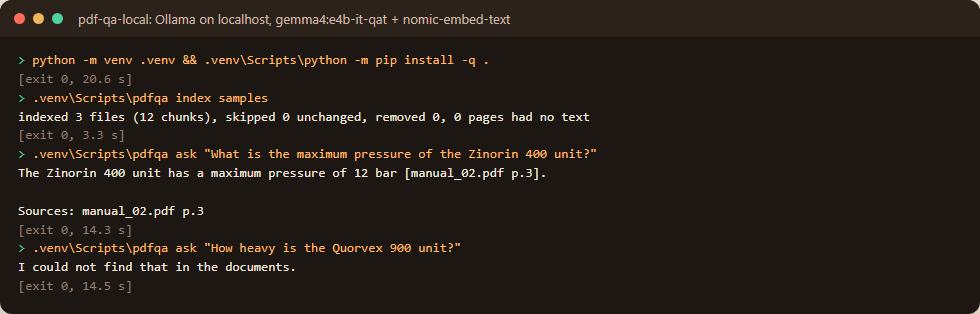
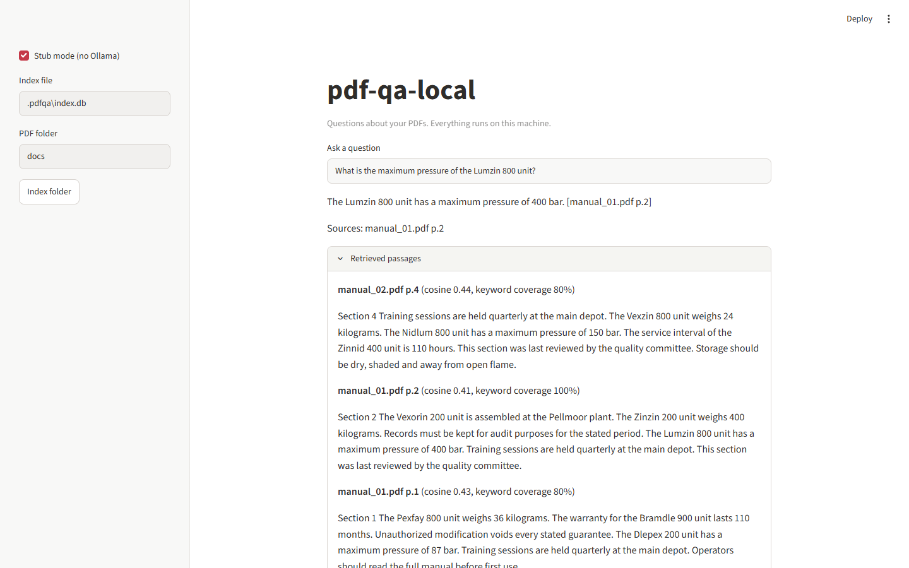

# pdf-qa-local

[](https://github.com/chasebuilds/pdf-qa-local/actions/workflows/ci.yml)

Ask questions about a folder of PDFs and get answers that cite the file and page. The model and the embeddings both run on your own machine through [Ollama](https://ollama.com), so the documents never leave it. When the documents do not contain the answer, it says so.

Built by Chase Builds. Useful for contracts, manuals, policies and reports that cannot be uploaded to a hosted AI service.

**Measured on invented test manuals with a local model:** the cited page was right on 29 of 30 answerable questions, and all 12 questions the documents could not answer were refused. Details in [Benchmark](#benchmark).

## See it run

It needs a local model through Ollama, so there is no browser demo. This is a real run on the three invented manuals in [`samples/`](samples/) with Ollama on localhost (`gemma4:e4b-it-qat` for answers, `nomic-embed-text` for embeddings): index, one question the manuals answer, one they do not. Captured from the terminal unedited ([full transcript](docs/run.txt)).



The answer is right: [`samples/manual_02.pdf`](samples/manual_02.pdf) page 3 gives the Zinorin 400 a maximum pressure of 12 bar. The Quorvex 900 is in none of the manuals, so the model is not asked and the tool says so.

### Run it yourself in 3 commands

Needs [Ollama](https://ollama.com) running with `ollama pull gemma4:e4b-it-qat` and `ollama pull nomic-embed-text` done once. After `git clone https://github.com/chasebuilds/pdf-qa-local` and `cd pdf-qa-local` (Windows shown; on macOS or Linux use `python3` and `.venv/bin/`):

```
python -m venv .venv && .venv\Scripts\python -m pip install -q .
.venv\Scripts\pdfqa index samples
.venv\Scripts\pdfqa ask "What is the maximum pressure of the Zinorin 400 unit?"
```

No Ollama? `.venv\Scripts\pdfqa --stub index samples` and `--stub ask` run the same pipeline offline with hashed embeddings and an extractive stub instead of a model.

## How it works

```
PDFs -> text per page -> chunks (never cross a page) -> embeddings -> SQLite index
question -> BM25 keyword score + vector cosine -> reciprocal rank fusion -> top chunks
         -> strength check (weak = "I could not find that in the documents.")
         -> local model answers from the chunks and cites [file.pdf p.N]
         -> citations the model invented are dropped
```

- **Local only.** The Ollama URL must be a loopback address. Any other host is refused unless you set `PDFQA_ALLOW_REMOTE=1`.
- **Hybrid retrieval.** BM25 catches exact names and numbers, vectors catch paraphrases. The two rankings are fused.
- **Page references.** Chunks are cut per page, so every citation is a real page.
- **Refusal.** If no top chunk matches the question's words and word pairs, or is close enough by vector, the model is not called.
- **Incremental index.** Re-running `index` skips unchanged files (SHA-256) and drops deleted ones.



## Install

```powershell
pip install -e .            # CLI
pip install -e ".[ui]"      # plus the Streamlit page
ollama pull gemma4:e4b-it-qat
ollama pull nomic-embed-text
```

## Use

```powershell
pdfqa index docs/
pdfqa ask "What is the warranty period for the Zintal 400 unit?"
```

```
The warranty for the Zintal 400 unit lasts 60 months [manual_04.pdf p.3].

Sources: manual_04.pdf p.3
```

```powershell
pdfqa --stub index docs/    # offline demo with no model (extractive stub, hashed embeddings)
streamlit run src/pdfqa/ui.py
```

Settings by environment variable: `PDFQA_MODEL` (default `gemma4:e4b-it-qat`), `PDFQA_EMBED_MODEL` (default `nomic-embed-text`), `PDFQA_OLLAMA_URL` (default `http://localhost:11434`). The index lives in `.pdfqa/index.db`; change it with `--db`.

## Benchmark

`bench/synth.py` writes PDFs with reportlab from invented content (made-up product names, pressures, warranties, plants) and a question list with known answers: 90 answerable questions across 6 manuals, plus 12 that the documents cannot answer (8 about products that do not exist, 4 unrelated). The stub's refusal threshold was adjusted while looking at corpus seed 1. The Ollama defaults were never tuned. Numbers below are on seed 2.

```powershell
python -m bench.run --stub              # offline
python -m bench.run --ollama --limit 30 # real local models, needs Ollama running
```

| | Stub (hashed words + extractive) | Ollama (`nomic-embed-text` + `gemma4:e4b-it-qat`) |
|---|---|---|
| Questions run | 90 answerable, 12 not answerable | 30 answerable (every third), 12 not answerable |
| Right page in top 5 | 98.9% | 100% |
| Right page ranked first | 77.8% | 80.0% |
| Answer contains the fact | 97.8% | 96.7% |
| Citation includes the right file and page | 97.8% | 96.7% |
| Refused although answerable | 2.2% | 0% |
| Correctly refused when not in the documents | 75.0% | 100% |
| Seconds per question | under 0.1 | 12.0 (machine shared with other jobs) |

Raw results: `bench/results-stub-seed2.json`, `bench/results-ollama-seed2.json`. The Ollama run is one pass, 42 questions, on one machine (RTX 5070, 12 GB). With 12 refusal questions, each one is 8.3 points, so treat the refusal rate as rough. On seed 1 the same Ollama setup scored 100% / 86.7% / 100% / 100% / 0% / 75% on the same rows (30 questions).

## Tests

```powershell
pip install -e ".[dev]"
ruff check . ; mypy ; pytest
```

The tests use the hashed-word embedder and an extractive stub model, so they need no Ollama and no network. CI runs ruff, mypy, pytest and the stub benchmark on Python 3.10 and 3.12.

## Limitations

- **Text PDFs only.** Scanned pages with no text layer are skipped (the index command reports how many). There is no OCR.
- **Tables and multi-column layouts** come out in whatever order pypdf reads them, which can scramble a row or a column.
- **Near-miss names can slip through the refusal check.** A question about "Quorvex 900" can match a chunk that says "Quorvex 400" because most words overlap. The model prompt tells it that a similar name is not a match, but a small model still gets this wrong sometimes.
- **The refusal thresholds are tuned on one synthetic corpus.** Real documents with different wording may need different values. They are arguments of `Retriever` (`min_coverage`, `min_phrase`, `min_cosine`).
- **The whole index is loaded into memory** and BM25 is computed in Python at query time. That is fine for hundreds of documents, not for hundreds of thousands.
- **The synthetic benchmark is easy.** Questions share exact product names with the text. It checks the pipeline and citation logic, not how well the system reads messy real documents.
- **The stub model is not a language model.** It returns the best matching sentence, so stub numbers measure retrieval and citation plumbing only.
- **A local 4B model can be wrong** even with the right passage. Check the cited page.

## License

MIT, Chase Builds.

## More from Chase Builds

- **[site-security-check](https://github.com/chasebuilds/site-security-check)**: A gentle, passive checkup of your own website, with a plain-English grade and fixes in order. ([live demo](https://chasebuilds.github.io/site-security-check/))
- **[table-export-extension](https://github.com/chasebuilds/table-export-extension)**: Export any web table to Excel. No data leaves the browser. ([live demo](https://chasebuilds.github.io/table-export-extension/))
- **[webgpu-agent-kit](https://github.com/chasebuilds/webgpu-agent-kit)**: Helps AI coding agents write GPU code that actually runs. 10 of 10 examples render clean. ([live demo](https://chasebuilds.github.io/webgpu-agent-kit/))

[All projects, sorted by industry](https://github.com/chasebuilds) · [chasebuilds.github.io](https://chasebuilds.github.io)
